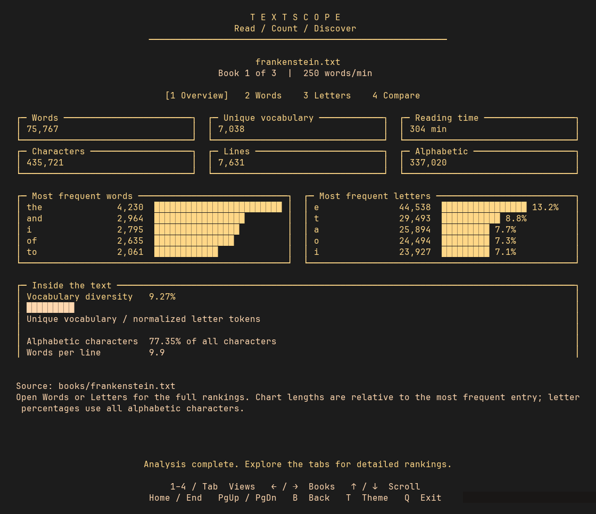

# TextScope — Text Analyzer

**Explore the words, letters, and vocabulary inside your books.**

TextScope reads text one line at a time, preserves the original word and letter counts, and adds vocabulary rankings, reading-time estimates, and multi-book comparisons. Export readable text, structured JSON, or a CSV summary without third-party dependencies.

[Analyze a book](#-quick-start)

##  Features

- Start from a centered menu: pick your own book or browse the library.
- Explore an analysis dashboard with metric panels and word/letter charts.
- Choose cover-inspired dark, paper, high-contrast, or terminal-default themes.
- Use plain output for screen readers and pipelines.
- Count words and letters and rank normalized vocabulary.
- Compare several books in one report.
- Export text, JSON, or CSV without third-party dependencies.
- Write reports atomically and reject overwriting an input book.

##  Installation

Requires **Python 3.10+**. No pip install, virtual environment, API key, or build step is needed.

```bash
git clone https://github.com/yaqyn/textscope-text-analyzer.git
cd textscope-text-analyzer
./launch
```

After cloning, **`./launch` is the only startup command**.

##  Quick start

```bash
./launch
```

In an interactive terminal, `./launch` opens a centered menu:

- **Pick your book** opens a desktop file browser. Select a plain-text file to analyze it.
- **Library** shows the bundled books and any books opened during the session. Select one or more with **Space**, then press **Enter**.
- **Exit** returns to your terminal.

The file picker uses Zenity, KDialog, or Python's Tk dialog when available. Without
a working desktop picker, TextScope opens its own terminal file browser: use
arrows and Enter to navigate folders and choose a file. Hidden files are omitted
from this fallback browser. Selected books are read locally; nothing is uploaded.

To supply your own library candidates, run
`./launch --interactive path/to/book.txt another.txt`. Explicit file commands
without `--interactive` print reports directly. Redirected output defaults to the
bundled Frankenstein report. The launcher works from another directory when
invoked by absolute path.

### Analysis dashboard

The **Overview** shows six metric panels, word and letter frequency charts,
vocabulary diversity, alphabetic share, words per line, and the source path.
**Words** and **Letters** reveal full rankings. **Compare** shows collection totals
and a relative word-count chart for each analyzed book. Numeric values accompany
charts, and every dashboard scrolls when it exceeds the terminal height.



### Terminal controls and accessibility

| Key | Action |
| --- | --- |
| Up / Down or K / J | Choose a menu item, move through books, or scroll the dashboard |
| Enter | Open a menu item/folder/file, or analyze selected books |
| P / L | Open Pick your book / Library from the main menu |
| Space | Toggle a library selection; page down in the dashboard |
| A | Select or deselect all library books matching the filter |
| / | Filter library or file-browser paths; Enter applies, Esc clears |
| 1–4 / Tab / Shift+Tab | Switch dashboard views |
| Left / Right | Switch between analyzed books |
| Page Up / Page Down | Move a page |
| Home / End | Jump to the beginning or end |
| B / Esc | Return to the previous screen; cancel the picker or pending analysis |
| T | Cycle library, paper, contrast, and terminal themes |
| S | Toggle compact and roomy list spacing |
| Q | Exit from any screen; Ctrl+C also restores the terminal |

```bash
./launch --theme paper --spacing roomy
./launch --interactive books/*.txt --theme contrast
./launch --plain
NO_COLOR=1 ./launch
```

The library palette follows the cover's parchment, gold, ink, and burgundy.
Themes affect only the application; preferences last for the session. Repeatable
startup choices use flags. `NO_COLOR` or `--no-color` disables application colors
and theme cycling. The terminal theme uses your own foreground and background.
Selection always includes a `>` cursor and `[x]` checkbox, so color is optional.
Eight-color terminals use fallback colors; there is no animation or mouse requirement.

For screen readers, use **`--plain`**: output follows a linear reading order with
no screen clearing, colors, cursor movement, or interactive prompts. JSON and CSV
also remain free of terminal styling. Reports wrap in the interactive reader;
windows below 36 columns or 16 rows show resize guidance and allow exit.

Font size and font family belong to your terminal emulator. Use its zoom controls
(often Ctrl+Shift+Plus / Ctrl+Minus; consult your terminal's shortcuts) or font
settings. Roomy spacing adds blank rows without changing glyph size. Wide Unicode
glyph alignment and right-to-left rendering depend on terminal support. Screen
reader and individual terminal compatibility have not been exhaustively tested.

Interactive mode requires Python's `curses` module and a working terminal.
If unavailable, use `./launch --plain` or an explicit file command.

##  Usage

Try the other bundled books:

```bash
./launch books/mobydick.txt
./launch books/prideandprejudice.txt
```

```bash
./launch books/frankenstein.txt books/mobydick.txt --top 15 --min-word-length 5 --exclude their
./launch books/frankenstein.txt --format json --output reports/frankenstein.json
./launch books/*.txt --format csv --output reports/comparison.csv
```

| Option | What it controls |
| --- | --- |
| `--top N` | Number of ranked words; default 10 |
| `--no-vocabulary` | Hide ranked words while preserving counts, reading time, and other totals |
| `--min-word-length N` | Minimum length for word rankings; default 1 |
| `--max-word-length N` | Optional maximum length for word rankings |
| `--exclude WORD` | Exclude a word from rankings; repeat for several words, or use repeatable `--exclude-file PATH` for UTF-8 files with one word per line (`#` comments and an optional leading BOM are ignored) |
| `--reading-wpm N` | Reading-speed estimate; default 250 words per minute |
| `--encoding NAME` | Input encoding; default UTF-8 |
| `--format text/json/csv` | Readable report, full structured analysis, or summary rows |
| `--output PATH` | Save instead of printing; creates parent directories |
| `--interactive` | Open the terminal interface, using supplied files as library candidates |
| `--plain` | Force linear text output, including with no files |
| `--theme library/paper/contrast/terminal` | Interactive appearance; default library |
| `--no-color` | Disable application color pairs; also honors `NO_COLOR` |
| `--spacing compact/roomy` | Interactive row spacing; default compact |

###  Counting rules

- **Word count:** whitespace-separated tokens, preserving the course definition.
- **Letters:** lowercase character counts, alphabetic characters only, sorted by frequency and alphabetically on ties.
- **Vocabulary:** Unicode letter tokens, with optional internal apostrophes. NFC normalization merges composed and decomposed accents. Casefolding merges forms such as `Straße` and `STRASSE`; curly and straight apostrophes are equivalent. Numbers are excluded. This is a simple tokenizer, not a language-specific word segmenter.
- **Vocabulary percentage:** unique normalized vocabulary divided by all letter tokens. Filters affect rankings only.
- **Reading time:** whitespace word count divided by the selected words per minute, rounded up; empty books take zero minutes.
- **Characters and lines:** decoded code points and physical text lines, preserving line endings. No sentence/readability model is implied.

JSON always contains a list of book analyses, including letter counts and top words. CSV contains one summary row per book. Multiple-book text reports include a comparison table. The file is streamed by line; memory use grows with distinct vocabulary and the longest line rather than the full book.

Input and output encoding failures return status 1 with a concise error; invalid CLI arguments return status 2. Use `--encoding` when a text file is not UTF-8. Every input must succeed before a report is written. Reports are replaced atomically, and the CLI rejects using an input book or exclusion file as the output path.

##  Architecture

The CLI reads text, computes counts and vocabulary, and renders or exports the report.


| File | Responsibility |
| --- | --- |
| `main.py` | CLI, text/JSON/CSV reports, and atomic output |
| `terminal_ui.py` | Centered menu, file picker, library, themes, and dashboard |
| `DESIGN.md` | Cover palette, layout, and accessibility decisions |
| `stats.py` | Streaming analysis, vocabulary, and counting helpers |
| `books/` | Three bundled books to explore |
| `test_textscope.py` | Counting, Unicode, CLI, exports, and launcher checks |
| `test_terminal_ui.py` | Dashboard values, navigation, picker recovery, and narrow layouts |

##  Verification

```bash
python3 -m unittest -v
```

The tests need no external services. They compare all bundled books against the original counting functions, test the launcher from another directory, and exercise empty text, Unicode, filters, encoding errors, multiple-book exports, and atomic-write recovery. GitHub Actions runs the checks on Python 3.10 and 3.13.

##  Learning context

Reading files, working with counters and dictionaries, deterministic sorting, Unicode normalization, dataclasses, CLI design, and structured exports.

---

Built by **[Abdulrahman M. Yaqyn](https://yaqyn.github.io/folio-static-site/)**.

> **Learning Journey Project · Boot.dev**
> Developed through the Boot.dev curriculum and extended through independent work.
